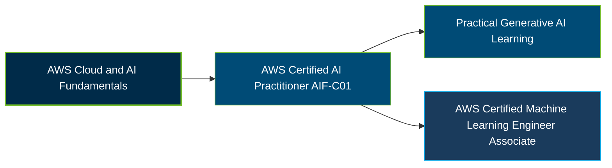

# AWS Certified AI Practitioner (AIF-C01) Certification Exam Guide

A dedicated, comprehensive study guide and AI reference repository for candidates preparing for the **AWS Certified AI Practitioner (AIF-C01) Certification Exam**.

---

## Exam Overview

The AWS Certified AI Practitioner certification validates foundational knowledge of artificial intelligence, machine learning, generative AI, and AWS AI services, including their practical business applications and responsible use.

- **Exam Format**: Multiple-choice, multiple-response, ordering, and matching questions; testing center or online proctored exam
- **Target Audience**: Professionals in cloud, development, data, IT, AI/ML, and business roles who use or are exploring AI technologies
- **Prerequisites**: No formal prerequisite; AWS describes the target candidate as having up to six months of exposure to AI/ML technologies on AWS

---

## Core Exam Domains & Knowledge Areas

### 1. Fundamentals of AI and ML

- Core AI and ML terminology, concepts, learning methods, and inferencing.
- AI/ML use cases, data types, and the AI/ML development lifecycle.
- Differences between AI, machine learning, deep learning, and generative AI.

### 2. Fundamentals of GenAI

- Generative AI concepts, foundation models, tokens, embeddings, and prompt engineering.
- Capabilities, limitations, and business use cases of generative AI.
- AWS infrastructure and technologies for generative AI applications.

### 3. Applications of Foundation Models

- Selecting appropriate foundation models for specific use cases.
- Prompt engineering, retrieval-augmented generation, and model customization concepts.
- Evaluating foundation model outputs and application performance.

### 4. Guidelines for Responsible AI

- Responsible AI principles, fairness, bias, and transparency.
- Explainability, robustness, safety, and limitations of AI systems.
- Human oversight and responsible evaluation of AI-generated outputs.

### 5. Security, Compliance, and Governance for AI Solutions

- Security and privacy considerations for AI workloads and data.
- AWS security, compliance, and access control fundamentals.
- Governance, risk management, and responsible use of AI services.

---

## Certification Path

This is a suggested learning progression, not a mandatory certification sequence. AWS identifies the Machine Learning Engineer - Associate as one possible next certification for candidates pursuing AI and machine learning careers.

---

## Recommended Practice & Study Resources

Combine official AWS exam preparation materials with practical exploration of AI concepts, generative AI applications, and responsible AI principles.

- **CertsGate**: Explore [AIF-C01 certification preparation resources](https://certsgate.com/exams/amazon/aif-c01) for supplementary study materials and practice questions.
- **Practical AI Study**: Use the [Amazon Bedrock documentation](https://docs.aws.amazon.com/bedrock/) to explore foundation models, generative AI applications, and responsible AI implementation concepts.
